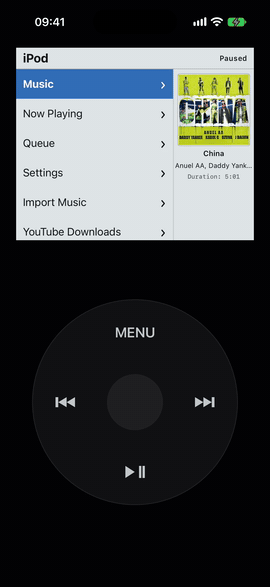
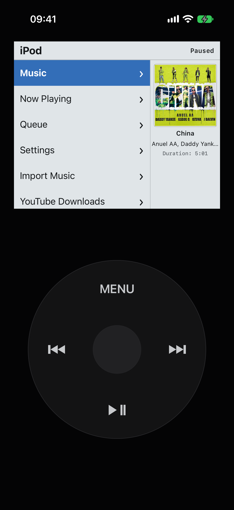
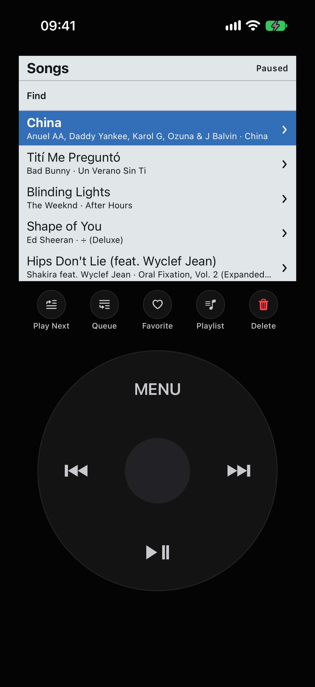
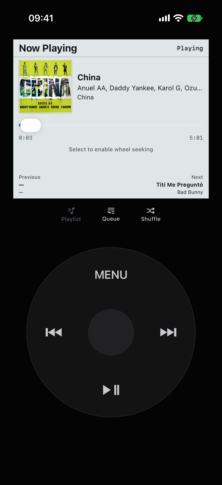
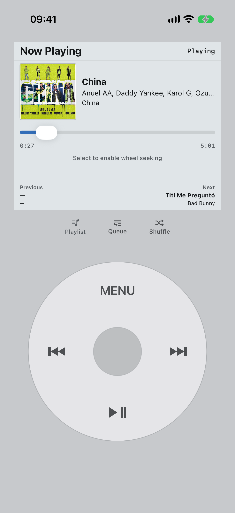

# VIPOD

VIPOD is a native SwiftUI music player for iPhone and iPad with an iPod Classic-inspired interface for local music. It imports audio files into app-owned storage, browses them with an on-screen click wheel, and keeps the library, collections, and playback session across launches.

## Demo

<p align="center">
  <a href="docs/video/vipod-demo.mp4">
    
  </a>
</p>
<p align="center"><em>Browse the menus and play real music — <a href="docs/video/vipod-demo.mp4">watch the full demo with sound (MP4)</a></em></p>

## Screenshots

Explore the main menu, library songs, and Now Playing in both appearance themes:

<p align="center">
  
  &nbsp;
  
</p>
<p align="center"><em>Main menu · Songs</em></p>

<p align="center">
  
  &nbsp;
  
</p>
<p align="center"><em>Now Playing · Black theme · White theme</em></p>

## Features

- iPod Classic-style menu with an on-screen click wheel; each menu remembers its position while you navigate.
- Songs, Artists, Albums, Playlists, Favorites, and Queue browsing. Albums group by album artist, compilations appear under “Various Artists,” and tracks follow disc/track numbers.
- Import from Files. Audio is copied into VIPOD’s own catalog; removing a song from the library never deletes the original file.
- Queue editing (move/remove), shuffle, repeat, artwork, and a Now Playing screen.
- Playback restores the last track, queue order, shuffle order, repeat mode, and position after relaunch, always paused.
- Background audio, lock-screen/Control Center metadata, and remote play/pause/next/previous commands.
- Audio-output status, including the current Bluetooth connection when available.
- Black and White themes, selectable in Settings.
- YouTube Downloads on iOS, backed by an embedded Python/yt-dlp runtime; a Debug-only diagnostic and opt-in live UI tests cover the runtime end to end.

## Requirements

- macOS with **Xcode 26.3 or newer**. CI builds with 26.3; the tree is also verified on Xcode 27.2.
- **iOS/iPadOS 18.6 or newer** as a simulator or a signed device.
- **Python 3.12+ with `pip`** on `PATH` for the YouTube runtime bootstrap and repository scripts.
- Network access on the first checkout to download the pinned CPython iOS runtime and Python wheels.

The deployment target stays at iOS 18.6 regardless of the SDK you build with. The app and test targets use `SWIFT_DEFAULT_ACTOR_ISOLATION = MainActor`; see [Concurrency and actor isolation](#concurrency-and-actor-isolation) before changing isolation settings.

## Getting started

### 1. Prepare the YouTube runtime (once per checkout)

Every iOS build embeds a pinned CPython runtime and yt-dlp packages, so run this before the first build:

```sh
./scripts/bootstrap-youtube-runtime.sh
```

The script downloads the CPython 3.14 iOS XCFramework, verifies its SHA-256, downloads the pinned wheels, verifies them against `scripts/youtube-runtime-wheels.sha256`, and stages everything under `vendor/youtube-runtime/`. Those artifacts are ignored by Git. It is safe to re-run after pulling changes to the pinned versions. macOS builds do not use this iOS runtime.

### 2. Open and run

1. Open `vipod.xcodeproj` in Xcode.
2. Select the **vipod** scheme and an iOS 18.6-or-later destination (for example, **iPhone 17**).
3. Run with **Cmd+R**.
4. Choose **Import Music** and select audio files from Files.

Command-line build:

```sh
xcodebuild build -project vipod.xcodeproj -scheme vipod \
  -destination 'platform=iOS Simulator,name=iPhone 17' \
  -derivedDataPath .derivedData
```

Notes:

- The scheme’s **Run** action uses the **Release** configuration. The YouTube diagnostic is Debug-only; switch **Edit Scheme → Run → Build Configuration** to **Debug** before passing its launch arguments. UI tests always build Debug.
- Running on a physical device requires selecting your development team under **Signing & Capabilities**.
- On the simulator, add audio files to the Files app first, then pick them with **Import Music**. A physical device is the most reliable way to exercise background playback.

### 3. Use the player

Use the wheel to highlight a row and press the center to open it or start playback. Touch interactions only select a row; contextual actions appear in the panel below the LCD. In **Songs**, the delete action removes a song from VIPOD’s library without deleting the original audio file.

Open **Music** for Favorites, Artists, Albums, Playlists, and Songs. Open a playlist to play tracks in saved order, or use **Add Songs** to browse the library and press the wheel center to add a track. **Queue** shows upcoming tracks; select one and use the panel to move or remove it from playback. Playlist and favorite changes never delete library audio, and they survive relaunch.

Open **Settings** to choose the Black or White appearance. `iPodTheme` can be extended with additional palettes.

Playback is checkpointed periodically and flushed at playback changes and when the app scene becomes inactive or enters the background. An abrupt operating-system termination may lose progress since the last checkpoint.

## YouTube runtime (iOS)

The iOS target embeds Python 3.14 and pinned yt-dlp packages. The normal app exposes **YouTube Downloads** in the main menu. A Debug-only diagnostic screen additionally exercises extraction, format selection, validation, and import with detailed logs.

### Debug diagnostic

Pass these launch arguments to the **vipod** scheme (with the Run configuration set to Debug):

```text
--youtube-poc
--youtube-poc-autorun
--youtube-url=https://www.youtube.com/watch?v=jNQXAC9IVRw
```

Auto-run is opt-in and only applies when the diagnostic screen is explicitly selected. Console entries prefixed `YOUTUBE_POC` include sanitized challenge-provider diagnostics. The screen reports extraction, download, validation, and import results, and can play the saved local audio.

### Live UI tests

The live simulator test is explicitly opted in through the shared `YouTubeRuntime` test plan:

```sh
xcodebuild test -project vipod.xcodeproj -scheme vipod \
  -testPlan YouTubeRuntime \
  -destination 'platform=iOS Simulator,name=iPhone 17' \
  -only-testing:vipodUITests/YouTubeRuntimeUITests/testExplicitLiveYouTubeRuntimeImport
```

It exercises a real public video, accepts either a solved Apple WebKit N/Sig challenge or a non-gated client path that does not require one, downloads and imports the M4A, repeats extraction to verify the duplicate rule, then relaunches the app and plays the saved file. It uses `--uitesting-library-fixture` with `--uitesting-reset-library`, so the track is saved under the isolated `VIPOD-UITesting` catalog. A normal app-icon launch uses the `VIPOD` catalog and will not show that test track.

For the normal-catalog offline check, host-launch the diagnostic with the three arguments above **without** `--uitesting-library-fixture` or `--uitesting-reset-library`. After import, enable Airplane Mode, relaunch VIPOD from its app icon, and play the saved track from **Music → Songs**. If you intentionally test the fixture catalog instead, host-launch with `--uitesting-library-fixture` again and omit `--uitesting-reset-library` on relaunch; the app icon does not carry those test arguments. Neither live UI test toggles Airplane Mode.

To run the live test against the normal iOS library rather than its isolated UI-test catalog, use the device plan below. It leaves one “Me at the zoo” track in VIPOD’s library for the manual offline relaunch check; use the fixture-backed `YouTubeRuntime` plan for repeatable tests that should not change the normal catalog.

```sh
xcodebuild test -project vipod.xcodeproj -scheme vipod \
  -testPlan YouTubeRuntimeDevice \
  -destination 'platform=iOS,id=<DEVICE-UDID>' \
  -only-testing:vipodUITests/YouTubeRuntimeUITests/testExplicitLiveYouTubeRuntimeImport
```

### UI-test launch arguments

| Argument | Purpose |
| --- | --- |
| `--uitesting-library-fixture` | Use the isolated `VIPOD-UITesting` catalog. |
| `--uitesting-reset-library` | Recreate the isolated catalog at launch. |
| `--uitesting-long-list-fixture` | Populate the fixture catalog with 60 tracks. |
| `--uitesting-long-collection-fixture` | Add a 60-track playlist and favorites to the fixture catalog. |
| `--uitesting-youtube-preview` | Use deterministic YouTube extraction/import fixtures. |
| `--uitesting-youtube-download` | Use the deterministic download-driver fixture. |

These arguments exist only in Debug builds.

## Project structure

```text
vipod/
├── vipod/
│   ├── App/                    SwiftUI entry point, dependency composition, UI-test fixtures
│   ├── Core/DesignSystem/      Theme tokens and retro display components
│   ├── Features/
│   │   ├── Library/            Domain, Application, Infrastructure, Presentation
│   │   ├── Playback/           Domain, Application, Infrastructure, Presentation
│   │   └── YouTube/            Domain, Application, Infrastructure, Presentation
│   └── Navigation/             Destinations, menu selection, navigation state
├── vipodTests/                 Unit tests and audio fixtures
├── vipodUITests/               UI tests
├── scripts/                    Runtime bootstrap, Python tests, wheel checksums
├── docs/                       Screenshots and demo media
├── vendor/youtube-runtime/     Generated by the bootstrap script (Git-ignored)
└── vipod.xcodeproj
```

The project follows feature-oriented Clean Architecture. Domain describes music-player concepts, Application coordinates use cases, Infrastructure adapts Apple frameworks and storage, and Presentation renders SwiftUI. Dependencies point inward; only the composition root at `vipod/App/AppDependencies.swift` knows concrete implementations. Full conventions live in [`.agents/rules/architecture.md`](.agents/rules/architecture.md).

## Testing

The **vipod** scheme ships three shared test plans:

| Test plan | Targets | Notes |
| --- | --- | --- |
| `VIPODDefaultTests` | `vipodTests`, `vipodUITests` | Default plan. Live YouTube tests skip unless opted in. |
| `YouTubeRuntime` | `vipodUITests` | Sets `VIPOD_RUN_YOUTUBE_RUNTIME_TESTS=1`; live test uses the isolated fixture catalog. |
| `YouTubeRuntimeDevice` | `vipodUITests` | Also sets `VIPOD_YOUTUBE_REAL_LIBRARY=1`; live test uses the normal library. |

Run tests from Xcode’s **Test** action, or use:

```sh
# Unit tests
xcodebuild test -project vipod.xcodeproj -scheme vipod \
  -testPlan VIPODDefaultTests \
  -destination 'platform=iOS Simulator,name=iPhone 17' \
  -derivedDataPath .derivedData \
  -only-testing:vipodTests

# UI tests
xcodebuild test -project vipod.xcodeproj -scheme vipod \
  -testPlan VIPODDefaultTests \
  -destination 'platform=iOS Simulator,name=iPhone 17' \
  -derivedDataPath .derivedData \
  -only-testing:vipodUITests
```

Omit `-only-testing:` to run every test in the plan. Replace the destination name with any installed simulator, or use `platform=iOS,id=<DEVICE-UDID>` for a device.

Python-side checks for the YouTube payload:

```sh
python3 -m unittest discover -s scripts -p 'test_*.py'
```

`ClickWheelMenuPresentationTests` verifies the rendered wheel with Apple’s Vision OCR, which is runtime-sensitive. On Xcode 27.2 / iOS 27.2 the 760pt white case can fail to recognize `MENU` even though the wheel renders correctly; CI verifies tests on Xcode 26.3. Re-run on that runtime or a device before treating that single case as a regression.

Background playback should also be verified on a real device; the simulator does not reproduce every audio-session transition.

## Concurrency and actor isolation

Both the app and test targets build with `SWIFT_DEFAULT_ACTOR_ISOLATION = MainActor`. Types and protocols are therefore main-actor isolated unless declared otherwise. Protocols implemented by background actors are explicitly `nonisolated`:

| Protocol | Declaration |
| --- | --- |
| `TrackRepository` | `vipod/Features/Library/Domain/TrackRepository.swift` |
| `LibraryCollectionStore` | `vipod/Features/Library/Domain/LibraryCollectionCatalog.swift` |
| `PlaybackSessionStore` | `vipod/Features/Playback/Domain/PlaybackSession.swift` |

Keep those annotations. If an Xcode or toolchain switch produces:

```text
actor '…' cannot conform to global-actor-isolated protocol '…'
```

the cause is a protocol that is missing `nonisolated` (or a changed default-isolation setting), not the test doubles. The fix is to declare the protocol itself nonisolated:

```swift
nonisolated public protocol TrackRepository: Sendable {
```

Do not remove the annotation to work around an isolation error. The full test-target build (`xcodebuild build-for-testing`) succeeds on Xcode 27.2, and CI runs the tests on Xcode 26.3.

## Troubleshooting

| Symptom | Fix |
| --- | --- |
| Build fails around `vendor/youtube-runtime` or `Process Python Libraries` | Run `./scripts/bootstrap-youtube-runtime.sh` and build again. |
| Bootstrap reports a checksum mismatch | Remove the stale download (`rm -rf vendor/youtube-runtime`) and re-run the script. |
| `actor '…' cannot conform to global-actor-isolated protocol '…'` | Keep or restore `nonisolated` on the protocol; see [Concurrency and actor isolation](#concurrency-and-actor-isolation). |
| `Unable to find a destination matching …` | Install the requested simulator runtime, or pass an available device name/UDID. |
| Signing error on a physical device | Select your development team under Signing & Capabilities. |
| The YouTube diagnostic does not appear | The scheme’s Run action is Release; set Edit Scheme → Run → Build Configuration to Debug. |
| Live YouTube tests are skipped | Run them through the `YouTubeRuntime` or `YouTubeRuntimeDevice` plan; the default plan leaves them skipped. |
| `ClickWheelMenuPresentationTests` fails with `Vision must recognize…` | Runtime-sensitive OCR check; try the CI runtime (Xcode 26.3) or a device. |
| UI tests fail on their first run | Boot or erase the simulator (`xcrun simctl erase all`) and retry. |

## Continuous integration

- **iOS Tests** (`.github/workflows/ios-tests.yml`) runs on `macos-15` with Xcode 26.3: Python payload tests, the YouTube runtime bootstrap, Swift unit tests, and UI tests against an iPhone 17 simulator.
- **Build iOS IPA** (`.github/workflows/build-ipa.yml`) is manual-only (`workflow_dispatch`): it archives and exports a signed IPA when you dispatch it from the Actions tab. It expects the repository secrets `IOS_CERTIFICATE_P12_BASE64`, `IOS_CERTIFICATE_PASSWORD`, and `IOS_PROVISIONING_PROFILE_BASE64`.

## Contributing

Architecture, component, testing, and style rules live in [`.agents/rules`](.agents/rules/index.md). Reusable workflows and checklists live in [`.agents/skills`](.agents/skills). Read the relevant rule before adding a module, screen, audio capability, or test.
